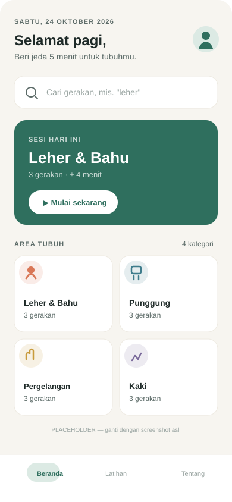
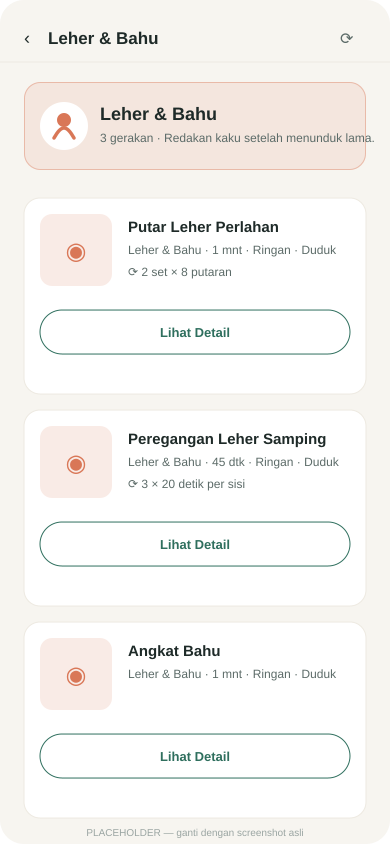
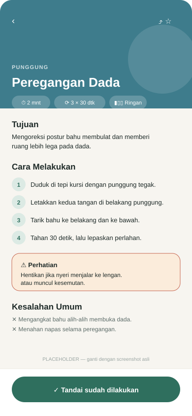
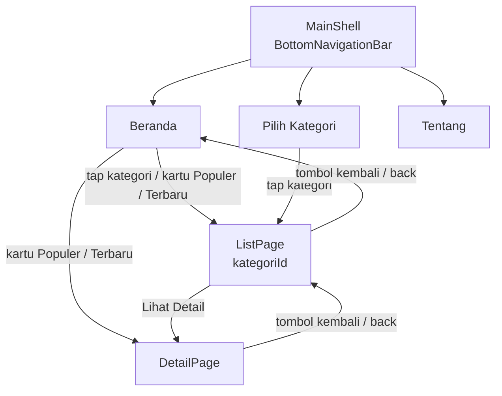

# Tapak — Panduan Peregangan & Ergonomi

Aplikasi mobile Flutter untuk membantu pekerja layar memberi jeda gerak di sela aktivitas duduk. Tapak menyediakan panduan peregangan singkat per area tubuh, lengkap dengan langkah, durasi, kesalahan umum, dan peringatan keselamatan.

Dibuat untuk **UTS Mobile Programming** — fokus pada perancangan GUI, navigasi, widget & layout, serta data dummy yang siap diganti API.

| | |
|---|---|
| **Tema** | Kesehatan kerja & ergonomi |
| **Platform** | Android, iOS, Web |
| **Bahasa** | Dart / Flutter (Material 3) |
| **Data** | JSON lokal (12 gerakan, 4 kategori) |
| **Status** | Siap dijalankan (`flutter run`) |

---

## 1. Tema dan Tujuan Aplikasi

**Tema:** *Tapak* — jejak langkah kecil untuk tubuh yang lebih nyaman. Aplikasi ini mengangkat kebiasaan mikro (peregangan 1–3 menit) sebagai solusi dari masalah nyata: kaku leher, punggung pegal, dan pergelangan tangan tegang akibat duduk terlalu lama di depan layar.

**Tujuan:**

1. Menyediakan katalog gerakan peregangan yang ringkas dan mudah dipahami pemula.
2. Mengelompokkan gerakan berdasarkan area tubuh agar pengguna cepat menemukan yang dibutuhkan.
3. Menampilkan instruksi bertahap, kesalahan umum, dan peringatan keselamatan pada setiap gerakan.
4. Menjadi contoh implementasi Flutter yang rapi: struktur folder jelas, data dummy terpisah, dan arsitektur siap API.

**Ruang lingkup:** edukasi dan pengingat gerak, **bukan** pengganti diagnosis atau terapi medis.

---

## 2. Fitur Utama

- Beranda dengan sapaan sesuai waktu, tanggal Indonesia, pencarian, kartu sesi hari ini, kategori, bagian **Populer**, dan **Terbaru**.
- Daftar gerakan per kategori dengan kartu, thumbnail, dan tombol **Lihat Detail**.
- Halaman detail dengan header berwarna kategori, chip informasi, langkah bernomor, peringatan, kesalahan umum, dan manfaat.
- Navigasi ganda: **BottomNavigationBar** untuk menu utama + **Navigator.push** untuk Beranda → Daftar → Detail.
- Pencarian lokal (nama, deskripsi, kategori, target otot).
- State lengkap: loading, error + coba lagi, hasil pencarian kosong, dan kategori kosong.
- Responsif: 2/3/4 kolom kategori, padding adaptif, konten dibatasi 900 px di layar lebar.
- Thumbnail fallback otomatis (ikon + gradien kategori) bila file gambar belum tersedia.
- Repository dapat ditukar dari JSON lokal ke REST API tanpa mengubah UI.

---

## 3. Screenshot

> **Placeholder.** Gambar di bawah adalah mockup SVG di `docs/screenshots/`. Ganti dengan hasil screenshot asli setelah menjalankan aplikasi (lihat cara di bagian [Screenshot Asli](#screenshot-asli)).

| Beranda | Daftar per Kategori | Detail Gerakan |
|:---:|:---:|:---:|
|  |  |  |

File placeholder yang tersedia:

```
docs/screenshots/
├── beranda.svg   # placeholder Beranda
├── daftar.svg    # placeholder Daftar per Kategori
└── detail.svg    # placeholder Detail Gerakan
```

### Screenshot Asli

1. Jalankan aplikasi (`flutter run`).
2. Ambil screenshot tiap halaman (PowerShell + ADB, atau tombol screenshot emulator).
3. Simpan sebagai `docs/screenshots/beranda.png`, `daftar.png`, `detail.png`.
4. Ganti ekstensi `.svg` pada tabel di atas menjadi `.png`.

---

## 4. Daftar Halaman dan Fungsinya

| No | Halaman | File | Fungsi |
|---|---|---|---|
| 1 | **Beranda** | `lib/pages/home_page.dart` | Sapaan & tanggal, pencarian, kartu sesi hari ini, grid kategori, daftar horizontal "Populer", daftar vertikal "Terbaru". Titik awal navigasi. |
| 2 | **Daftar per Kategori** | `lib/pages/list_page.dart` | Menerima `kategoriId` lewat constructor. Menampilkan header kategori + `ListView.builder` berisi `Card` (thumbnail, judul, subjudul, tombol "Lihat Detail"). Menampilkan state kosong bila tidak ada data. |
| 3 | **Detail Gerakan** | `lib/pages/detail_page.dart` | `SliverAppBar` dengan warna kategori, chip durasi/repetisi/tingkat/posisi, tujuan, target otot, langkah bernomor, peringatan, kesalahan umum, manfaat, dan tombol "Tandai sudah dilakukan". |
| 4 | **Pilih Kategori** | `lib/main.dart` (`_CategoryOverviewPage`) | Tab "Latihan" pada bottom navigation: pintasan ke daftar semua kategori. |
| 5 | **Tentang** | `lib/main.dart` (`_AboutPage`) | Informasi aplikasi, daftar fitur, dan ringkasan alur navigasi. |

**Shell navigasi:** `MainShell` di `lib/main.dart` memakai `IndexedStack` + `NavigationBar` (Beranda / Latihan / Tentang) sehingga perpindahan tab tidak menumpuk halaman dan state tetap terjaga.

### Alur Navigasi



- **Beranda → Daftar:** `Navigator.push(MaterialPageRoute(builder: (_) => ListPage(kategoriId: id)))`
- **Daftar → Detail:** `Navigator.push(MaterialPageRoute(builder: (_) => DetailPage(exercise: exercise)))`
- **Kembali:** tombol `‹` pada `AppBar`/`SliverAppBar` memanggil `Navigator.of(context).pop()`, sama seperti tombol Back sistem.

---

## 5. Struktur Folder

```text
tapak/
├── android/                      # Konfigurasi platform Android
├── ios/                          # Konfigurasi platform iOS
├── web/                          # Konfigurasi platform Web
├── assets/
│   ├── data/
│   │   └── exercises.json        # 12 data dummy, 4 kategori
│   └── images/
│       └── gerakan/              # Gambar gerakan (opsional, ada fallback ikon)
├── docs/
│   └── screenshots/              # Placeholder & screenshot aplikasi
├── lib/
│   ├── main.dart                 # Entry point, tema, MainShell + bottom nav
│   ├── models/
│   │   └── exercise.dart         # Model + fromJson/toJson/copyWith
│   ├── data/
│   │   ├── exercise_repository.dart       # Kontrak repository + exception
│   │   ├── local_exercise_repository.dart # Baca JSON via rootBundle (cache)
│   │   ├── api_exercise_repository.dart   # Implementasi http (siap pakai)
│   │   └── repository_provider.dart       # Saklar lokal ↔ API
│   ├── pages/
│   │   ├── home_page.dart        # Beranda
│   │   ├── list_page.dart        # Daftar per kategori
│   │   └── detail_page.dart      # Detail gerakan
│   ├── utils/
│   │   ├── app_theme.dart        # Palet, spacing, radius, tipografi
│   │   └── app_categories.dart   # Metadata ikon & warna kategori
│   └── widgets/                  # Siap diisi widget reusable
├── test/
│   ├── exercise_model_test.dart  # 3 test model
│   ├── home_page_test.dart       # 2 widget test Beranda
│   └── list_page_test.dart       # 2 widget test Daftar
├── pubspec.yaml
└── README.md
```

**Prinsip penamaan:** satu file = satu tanggung jawab; halaman di `pages/`, komponen reusable di `widgets/`, logika data di `data/`, tipe data di `models/`, token desain di `utils/`.

---

## 6. Data Dummy dan Struktur JSON

Data tersimpan di **`assets/data/exercises.json`** dan didaftarkan pada `pubspec.yaml`:

```yaml
flutter:
  assets:
    - assets/data/
    - assets/images/
    - assets/images/gerakan/
```

### Bentuk JSON

```json
{
  "meta": { "versi": 1, "diperbarui": "2026-10-24" },
  "data": [
    {
      "id": "ex-004",
      "nama": "Peregangan Dada di Kursi",
      "kategori": "punggung",
      "deskripsi": "Membuka area dada yang memendek akibat bahu membulat.",
      "gambar": "assets/images/gerakan/peregangan-dada.webp",
      "durasiDetik": 120,
      "repetisi": "3 × 30 detik",
      "tingkat": "Ringan",
      "posisi": "Duduk",
      "target": ["Otot pectoralis", "Otot depan bahu"],
      "tujuan": "Mengoreksi postur bahu membulat...",
      "langkah": ["Duduk di tepi kursi...", "..."],
      "kesalahanUmum": ["Mengangkat bahu...", "..."],
      "peringatan": "Hentikan jika terasa nyeri menjalar ke lengan...",
      "manfaat": ["Membuka area dada", "..."],
      "populer": true
    }
  ]
}
```

### Penjelasan Field

| Field | Tipe | Keterangan |
|---|---|---|
| `id` | String | Identitas unik, format `ex-XXX`. |
| `nama` | String | Judul gerakan. |
| `kategori` | String | Slug kategori: `leher-bahu`, `punggung`, `pergelangan-tangan`, `kaki`. |
| `deskripsi` | String | Ringkasan singkat untuk kartu. |
| `gambar` | String | Path aset lokal **atau** URL gambar. Bila kosong/gagal dimuat, UI memakai ikon kategori. |
| `durasiDetik` | int | Durasi total dalam detik; ditampilkan sebagai `1 mnt 30 dtk`. |
| `repetisi` | String | Teks bebas, mis. `2 set × 8 putaran`. |
| `tingkat` | String | `Ringan` atau `Sedang`. |
| `posisi` | String | `Duduk`, `Berdiri`, atau `Merangkak`. |
| `target` | List\<String\> | Otot/area yang dilatih. |
| `tujuan` | String | Manfaat utama gerakan. |
| `langkah` | List\<String\> | Urutan instruksi; ditampilkan bernomor. |
| `kesalahanUmum` | List\<String\> | Kesalahan yang perlu dihindari. |
| `peringatan` | String? | Null bila aman untuk umum. |
| `manfaat` | List\<String\> | Poin manfaat. |
| `populer` | bool | Penanda bagian "Populer" di beranda. |

### Isi Data

| Kategori | Jumlah | Contoh |
|---|---:|---|
| `leher-bahu` | 3 | Putar Leher Perlahan, Peregangan Leher Samping, Angkat Bahu |
| `punggung` | 3 | Peregangan Dada di Kursi, Kucing–Sapi, Putar Punggung Duduk |
| `pergelangan-tangan` | 3 | Ekstensor Pergelangan, Putar Pergelangan, Doa Terbalik |
| `kaki` | 3 | Berdiri–Duduk, Peregangan Betis, Ekstensi Kaki Duduk |

### Alur Data

```text
exercises.json
   │  rootBundle.loadString
   ▼
LocalExerciseRepository  ──►  List<Exercise>
   │                              │
   │ (kontrak ExerciseRepository) │
   ▼                              ▼
RepositoryProvider          HomePage / ListPage / DetailPage
```

Model `Exercise` memakai parsing defensif (`_asString`, `_asInt`, `_asStringList`, `_asBool`) sehingga data API yang tipenya tidak konsisten tidak membuat aplikasi crash.

### Menambah Data

1. Tambahkan objek baru ke array `data` di `assets/data/exercises.json`.
2. Pastikan `id` unik dan `kategori` memakai salah satu slug yang ada.
3. (Opsional) Taruh gambar di `assets/images/gerakan/` dan isi field `gambar`.
4. Jalankan ulang aplikasi (`flutter run`) — tidak perlu mengubah kode.

---

## 7. Rencana Integrasi API

Arsitektur sudah disiapkan agar migrasi tidak menyentuh halaman. `http` sudah ada di `pubspec.yaml`.

### Kontrak Endpoint

| Method | Endpoint | Respons |
|---|---|---|
| `GET` | `/exercises` | `{ "data": [ { ...exercise } ] }` |
| `GET` | `/exercises?kategori=punggung` | `{ "data": [ ... ] }` |
| `GET` | `/exercises/{id}` | `{ "data": { ...exercise } }` |

### Cara Mengaktifkan

`lib/data/repository_provider.dart` membaca konfigurasi build:

```bash
flutter run \
  --dart-define=USE_API=true \
  --dart-define=API_BASE_URL=https://domain-kamu/api/v1
```

Tanpa flag tersebut, aplikasi tetap memakai JSON lokal.

### Langkah Migrasi

1. **Siapkan backend** yang mengembalikan struktur field sama dengan JSON (lihat tabel field).
2. **Samakan nama field** atau sesuaikan `Exercise.fromJson` bila backend memakai `snake_case`.
3. **Ubah base URL** lewat `--dart-define` atau nilai default di `RepositoryProvider.apiBaseUrl`.
4. **Aktifkan** `USE_API=true`.
5. **Tangani autentikasi** (bila ada): tambahkan header di `ApiExerciseRepository._getJson`.
6. **Ganti `populer`** dengan metrik nyata (mis. `jumlahDilihat`) dan sesuaikan model.
7. **Uji** dengan `flutter test`; widget test memakai repository palsu sehingga tidak bergantung jaringan.

### Yang Sudah Ditangani

- Timeout 10 detik dan pesan error ramah pengguna (`ExerciseRepositoryException`).
- Decoding `utf8` dan validasi bentuk respons (`data` array/objek).
- Status 404 → `null` pada pencarian by id.
- Dukungan URL gambar di kartu dan halaman detail.

---

## 8. Cara Menjalankan

### Prasyarat

- Flutter SDK 3.x (Dart `^3.13.2`)
- Android Studio / VS Code + emulator, atau Chrome untuk web
- Koneksi internet saat pertama kali run (Google Fonts diunduh runtime; tanpa internet aplikasi tetap berjalan dengan font fallback)

### Langkah

```bash
# 1. Ambil dependency
flutter pub get

# 2. Jalankan aplikasi
flutter run

# Alternatif target
flutter run -d chrome          # web
flutter run -d emulator-5554   # emulator tertentu
```

### Perintah Pendukung

```bash
flutter analyze     # cek lint & error
flutter test        # 7 test (model + widget)
flutter build apk --release
```

### Troubleshooting

| Masalah | Solusi |
|---|---|
| `Unable to load asset: assets/data/exercises.json` | Jalankan `flutter clean && flutter pub get`, lalu restart aplikasi. Pastikan folder `assets/data/` terdaftar di `pubspec.yaml`. |
| Gambar gerakan tidak muncul | Normal: file `.webp` belum disediakan. UI otomatis memakai ikon kategori. Tambahkan gambar ke `assets/images/gerakan/`. |
| Font terlihat berbeda | `google_fonts` mengunduh font saat runtime. Untuk mode offline, unduh font dan aktifkan blok `fonts:` di `pubspec.yaml`. |
| Hot reload tidak memperbarui aset JSON | Tekan `R` (hot restart) atau jalankan ulang aplikasi. |

---

## 9. Pengujian

| File | Cakupan |
|---|---|
| `test/exercise_model_test.dart` | Parsing JSON lengkap, default saat field hilang, konsistensi `toJson`. |
| `test/home_page_test.dart` | Section Beranda tampil; pencarian menyaring data. |
| `test/list_page_test.dart` | Daftar terfilter per kategori; state kosong. |

```bash
flutter test
# 00:0x +7: All tests passed!
```

---

## 10. Desain

| Token | Nilai |
|---|---|
| Primary | `#2F6F5E` (Deep Teal) |
| Secondary | `#F2A65A` (Warm Amber) |
| Background | `#F7F5F0` (Bone) |
| Surface | `#FFFFFF` |
| Teks utama | `#1E2A28` (Ink) |
| Teks sekunder | `#5C6B68` (Slate) |
| Aksen kategori | Clay `#D97757`, Deep Cyan `#3E7C8C`, Mustard `#C89B3C`, Muted Plum `#7A6A9B` |
| Tipografi | Plus Jakarta Sans (judul) + Inter (body) |
| Grid | 4 kolom, margin 16, gutter 16, ritme 8 pt |
| Radius | 12 (chip), 16 (kartu), 20 (hero), 28 (header) |

### Referensi Desain

> **Sumber referensi desain: Task App, Figma Community (dimodifikasi).**

Referensi tersebut digunakan sebagai acuan pola tata letak (kartu, daftar horizontal, navigasi bawah), kemudian disesuaikan dengan tema kesehatan kerja, palet warna, tipografi, serta kebutuhan konten Tapak.

---

## 11. Lisensi dan Penulis

Proyek ini dibuat untuk keperluan akademik (UTS Mobile Programming). Silakan digunakan sebagai referensi belajar dengan mencantumkan sumber.

- **Nama:** _Muhammad Fachri Hafizh Saleh_
- **NIM:** _240605110175_
- **Kelas:** _Mobile Programming Practicum I_
- **Mata kuliah:** Mobile Programming
